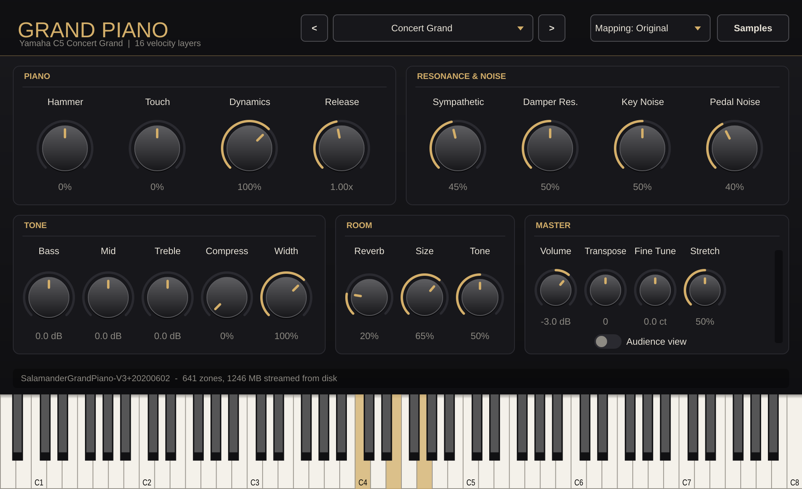

# Grand Piano

A realistic acoustic piano instrument plugin (VST3 / AU / Standalone) for FL Studio and other DAWs.
It's built like the commercial sampled pianos (Addictive Keys, Kontakt libraries): real recorded
samples streamed from disk, many velocity layers, mechanical noises, resonance and a mix-ready
effects section.



## Sound

The default instrument is the **Salamander Grand Piano V3**, a Yamaha C5 concert grand recorded at
48 kHz / 24-bit with two AKG C414 microphones:

- **16 velocity layers** for every minor third across all 88 keys (480 note samples)
- **Release samples**: chromatic key/hammer release noise and damper string resonance
- **Pedal samples**: sustain pedal down/up mechanics

The engine adds the behaviour of a real piano on top of the recordings:

| Feature | What it does |
|---|---|
| Damper model | Strings above F#6 have no dampers and ring on, like a real grand. Release time is adjustable |
| Sustain, sostenuto, soft pedal | CC64 / CC66 / CC67. Soft pedal (una corda) gives a softer, darker tone |
| Sympathetic resonance | With the sustain pedal down, undamped strings bloom with the played notes |
| Re-strike handling | Repeating a ringing note damps the previous vibration naturally |
| Hammer | Picks brighter or mellower velocity layers without changing loudness |
| Stretch tuning | Measures every sample's real pitch at load time: 0 % = exact equal temperament, 100 % = the piano's own recorded stretch |
| Disk streaming | Samples are decoded once into a memory-mapped cache, so instances share RAM and load in about a second |
| Effects | Bass/Mid/Treble EQ voiced for piano, glue compressor, stereo width, player/audience perspective, 8-line FDN room reverb, safety limiter |
| Presets | Concert Grand, Studio Pop, Warm Ballad, Bright Rock, Intimate Close, Cinematic Hall, Jazz Club, Soft & Dark, Audience Seat, Pure & Dry |

The engine reads **SFZ** instruments, so you can also load other SFZ pianos (*Samples > Load SFZ
instrument...*). If no samples are installed yet, a built-in modelled piano (additive synthesis with
inharmonic partials, two-string beating and double decay) plays so the plugin is never silent.

## Install (FL Studio, Windows)

1. Download the Windows package: the **GrandPiano-Windows** artifact from the latest
   [Actions run](../../actions), or a release zip.
2. Copy `Grand Piano.vst3` to `C:\Program Files\Common Files\VST3\`
3. In FL Studio: **Options > Manage plugins > Find installed plugins**. "Grand Piano" appears under
   Generators.
4. Load it in the Channel Rack, then click **Get Samples** (a free download of about 740 MB).
   The *WithSamples* package already contains the samples.

See [INSTALL-WINDOWS.txt](INSTALL-WINDOWS.txt) for details.

## Building

Requires CMake 3.22+ and a C++17 compiler (Visual Studio 2022, Xcode or GCC/Clang). JUCE is
downloaded automatically.

```bash
cmake -S . -B build
cmake --build build --config Release
```

On Linux, install the JUCE dependencies first, for example
`libasound2-dev libx11-dev libxrandr-dev libxinerama-dev libxcursor-dev libfreetype-dev libfontconfig1-dev libcurl4-openssl-dev`.

`-DGP_BUILD_TOOLS=ON` also builds `RenderTest`, an offline renderer that plays a test performance
through the plugin into a WAV file (and can snapshot the UI to PNG).

## Project layout

```
Source/
  PluginProcessor.*      audio processing chain, presets, state
  PluginEditor.*         user interface
  Parameters.*           parameter definitions and factory presets
  engine/SfzParser.*     SFZ instrument parser
  engine/SampleCache.*   FLAC/WAV decode -> memory-mapped 16-bit streaming cache
  engine/SampleManager.* background loading, prefetching, sample discovery
  engine/SampleDownloader.* sample download and .tar.gz unpacking
  engine/PianoEngine.*   voices, pedals, dampers, release triggers, modelled piano
  dsp/Effects.h          reverb, EQ, compressor, limiter
  ui/LookAndFeel.*       visual style
tools/RenderTest.cpp     offline render and test tool
```

## Credits and licences

- **Salamander Grand Piano V3** by Alexander Holm, licensed
  [CC-BY 3.0](https://creativecommons.org/licenses/by/3.0/). SFZ+FLAC edition by the
  [FreePats project](https://freepats.zenvoid.org/Piano/acoustic-grand-piano.html).
  The samples aren't stored in this repository. They're downloaded by the plugin or by the release
  build.
- Built with [JUCE](https://juce.com), which is dual-licensed under AGPLv3 and a commercial licence.
  If you distribute builds of this plugin, follow the terms of the licence you use JUCE under.
